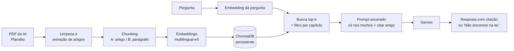

# Assistente RAG sobre a LGPD

Sistema de perguntas e respostas sobre a **Lei Geral de Proteção de Dados (Lei 13.709/2018)** com *Retrieval-Augmented Generation*: busca vetorial no ChromaDB e geração com o Gemini, restrita aos trechos recuperados, com citação do artigo. O foco do projeto é a **avaliação**: medir a recuperação contra um gabarito e checar se as respostas são sustentadas pelos trechos.

> Projeto de portfólio. **Não é aconselhamento jurídico.**

- Código: https://github.com/lucasnk1/RAG-LGPD
- Demo: roda no Colab com link temporário do Gradio. [](https://colab.research.google.com/github/lucasnk1/RAG-LGPD/blob/main/notebooks_lgpd_rag.ipynb)
  Não há demo permanente: em out/2026, Spaces com Gradio no Hugging Face exigiam plano pago, e o plano estático gratuito não executa Python no servidor.

## Resumo dos resultados

Todos os números abaixo saem do código deste repositório (`python -m src.evaluation` e `python -m src.fidelidade`), sobre **30 perguntas** com gabarito. Detalhes em `results/`.

### Recuperação (k = número de chunks recuperados)

| Configuração | Hit@1 | Hit@3 | Hit@5 | Recall@1 | Recall@3 | Recall@5 |
|---|---|---|---|---|---|---|
| e5-small + chunk por artigo (A) | 0,63 | 0,77 | 0,83 | 0,55 | 0,72 | 0,78 |
| e5-small + caput/parágrafos (B) | 0,57 | 0,77 | 0,87 | 0,48 | 0,70 | 0,82 |
| e5-base + chunk por artigo (A) | 0,60 | 0,73 | 0,87 | 0,50 | 0,70 | 0,85 |
| e5-base + caput/parágrafos (B) | 0,60 | 0,73 | 0,80 | 0,50 | 0,68 | 0,77 |

**Leitura honesta:** com 30 perguntas, cada pergunta vale 0,033. As diferenças entre as quatro configurações são de 1 a 3 perguntas, então **não há vencedor estatisticamente defensável**. O modelo maior (e5-base) não superou o menor de forma clara. Duas perguntas (#2 "Quem é o controlador?" e #26 "Natureza jurídica da ANPD") falharam em **todas** as configurações, o que indica que o gargalo ali não é o modelo nem o tamanho do chunk.

### Geração e fidelidade (e5-small + chunk por artigo, k = 5)

Amostra de 15 perguntas do gabarito (sorteio com semente fixa) + 3 perguntas fora do escopo.

| Medida | Resultado |
|---|---|
| Respostas com conteúdo, marcadas manualmente | 11 de 15: **8 sustentadas, 3 parciais, 0 não sustentadas** |
| Recusas ("Não encontrei na lei.") em perguntas com gabarito | 4 de 15 (a busca não trouxe o artigo certo) |
| Citações apenas de artigos recuperados (calculado pelo código) | 15 de 15 |
| Recusa correta em perguntas fora do escopo | 3 de 3 |

As 3 respostas parciais são **omissões** (o modelo resumiu e deixou de fora condições ou parágrafos), não invenções. Com 15 itens, cada resposta pesa ~7 pontos percentuais: leia como "8 de 11", não como uma taxa.

## Pipeline



## Decisões técnicas

- **Fonte congelada:** o texto vem do PDF compilado do Planalto (`data/`), obtido em 28/10/2026. O texto da lei já foi alterado em 2026 (Lei 15.352), então congelar a versão mantém o gabarito consistente.
- **Limpeza:** remove anotações de alteração legislativa ("Redação dada pela…"), cabeçalhos e rodapés de página, e corrige um defeito do original ("Art. 5 7." no lugar de "Art. 57."). Artigos vetados ou revogados (28, 55, 55-B, 56 a 59) ficam fora do índice: **73 artigos** indexados.
- **Chunking:** (A) um chunk por artigo; (B) caput com incisos e cada parágrafo separados, com o prefixo "Art. N" repetido. Metadados: artigo, parte, capítulo, seção.
- **Embeddings:** `multilingual-e5-small` e `-base`, com os prefixos `query:` e `passage:` exigidos pelo modelo e vetores normalizados (distância de cosseno).
- **Avaliação:** k conta **chunks** (mesmo orçamento de contexto nas duas configurações); os resultados são reduzidos a artigos únicos antes de comparar com o gabarito. *Hit@k* = fração de perguntas com pelo menos um artigo correto; *Recall@k* = fração média dos artigos corretos recuperados.
- **Prompt:** obriga a responder só com os trechos, citar o artigo, e responder exatamente "Não encontrei na lei." quando faltar contexto.
- **Robustez da geração:** limite rígido de 30 s por chamada, uma nova tentativa e modelo reserva (`gemini-3.5-flash` → `gemini-3.1-flash-lite`). O modelo que respondeu é registrado em cada resposta.

## Como reproduzir

Testado com Python 3.14 no Windows (outras versões e sistemas não foram testados). Requer uma chave gratuita do Google AI Studio (`GEMINI_API_KEY`). **Nunca coloque a chave no código ou no repositório.**

```powershell
python -m venv .venv
.\.venv\Scripts\python.exe -m pip install -r requirements.txt

.\.venv\Scripts\python.exe -m src.ingestion      # PDF -> chunks em data/processed/
.\.venv\Scripts\python.exe -m src.indexing       # indexa as 4 coleções no ChromaDB
.\.venv\Scripts\python.exe -m src.evaluation     # tabela de recuperação em results/

$env:GEMINI_API_KEY = "sua_chave"
.\.venv\Scripts\python.exe -m src.rag "Qual o prazo para comunicar um incidente de segurança?"
.\.venv\Scripts\python.exe -m src.fidelidade gerar    # gera respostas da amostra
.\.venv\Scripts\python.exe app.py                     # demo Gradio local
.\.venv\Scripts\python.exe -m pytest -q tests
```

No Colab, guarde a chave em *Secrets* com o nome `GEMINI_API_KEY`. O `app.py` também serve para um Space do Hugging Face com SDK Gradio (plano pago): defina a chave em *Settings > Secrets*; o índice é reconstruído no primeiro start. Esse caminho não foi testado.

## Estrutura

```
app.py                      demo Gradio
src/
  ingestion.py              PDF -> artigos -> chunks com metadados
  embeddings.py             modelos e5 (prefixos query/passage)
  indexing.py               ChromaDB persistente
  query.py                  busca top-k + filtro por metadados
  generation.py             prompt ancorado, Gemini (e Ollama, não testado)
  rag.py                    pipeline completo
  evaluation.py             hit rate e recall@k
  fidelidade.py             amostra, revisão manual e resumo
data/
  lgpd_L13709_compilado.pdf fonte congelada
  processed/                chunks (A e B)
  eval/perguntas.jsonl      gabarito: 30 perguntas com artigo e citação
results/                    tabelas, respostas e marcação de fidelidade
tests/                      testes de ingestão, gabarito e geração
scripts/diagnostico_gemini.py
notebooks_lgpd_rag.ipynb
```

## Ferramentas

Python, pypdf, sentence-transformers (multilingual-e5), ChromaDB, Gemini (`google-genai`), Gradio, pytest.

## Limitações

- **Avaliação pequena.** 30 perguntas e 15 respostas checadas. As diferenças entre configurações estão dentro do ruído, e nenhuma conclusão de "melhor configuração" é sustentada.
- **Gabarito com viés provável.** O gabarito foi elaborado e conferido contra o texto da lei com apoio de um assistente de IA (Claude), sem revisão jurídica independente. A maioria das perguntas usa vocabulário próximo ao da lei, o que tende a inflar a recuperação. Há 6 perguntas com mais de um artigo correto; outras podem admitir mais de um.
- **Checagem de fidelidade.** A marcação (sim, parcial, recusa) foi feita por um único avaliador, com apoio de um assistente de IA na redação das observações, e sem medida de concordância entre avaliadores. A amostra é pequena e os itens parciais merecem releitura.
- **Falhas de recuperação reais.** 4 de 15 perguntas receberam recusa porque o artigo certo não foi recuperado (por exemplo, as definições do art. 5, que é um chunk de ~6.000 caracteres). O sistema prefere recusar a inventar, o que é seguro, mas pouco útil.
- **Sem reranking.** Foi planejado como comparação, mas ficou de fora por tempo. Seria o próximo experimento, junto de dividir o art. 5 por inciso.
- **Respostas incompletas.** O modelo omite condições e parágrafos (3 de 11 respostas parciais).
- **Geração não determinística e dependente de serviço gratuito.** Os modelos Gemini usados ignoram `temperature`. Durante o desenvolvimento ocorreram erros 503 e 504 e timeouts. Na geração das 18 respostas da amostra, o `gemini-3.5-flash` ficou sem responder por 90 s em pelo menos uma tentativa em 3 itens (G29, F2 e F3), com respostas normais em 3 a 6 s; por isso o limite atual é de 30 s. A mitigação é o fallback, não uma garantia. 16 respostas da amostra vieram do `gemini-3.5-flash` e 2 do `gemini-3.1-flash-lite`.
- **Escopo único.** Apenas a LGPD (sem regulamentos da ANPD, jurisprudência ou outras leis).
- **Notebook.** O notebook (seções 1 a 5) foi executado de ponta a ponta no Colab pelo autor em out/2026, sem erros. Não há teste automatizado do notebook, e o link público da demo é temporário (expira com a sessão).
- **Ollama.** A opção local existe no código, mas não foi testada.

## Licença

MIT (veja `LICENSE`). O texto da lei é público e oficial.
